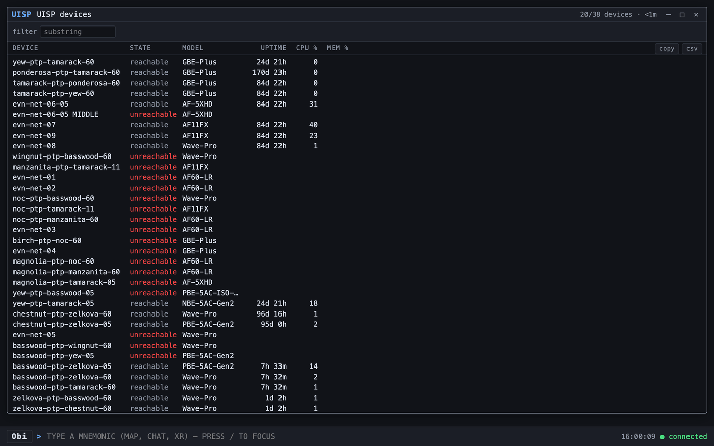
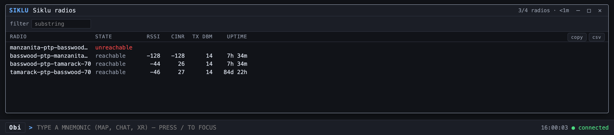
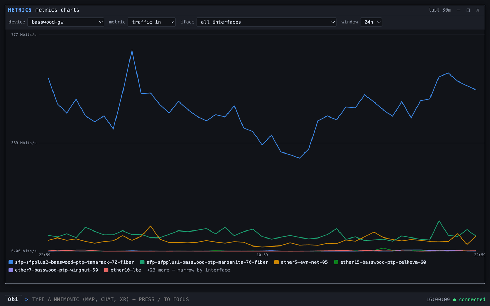
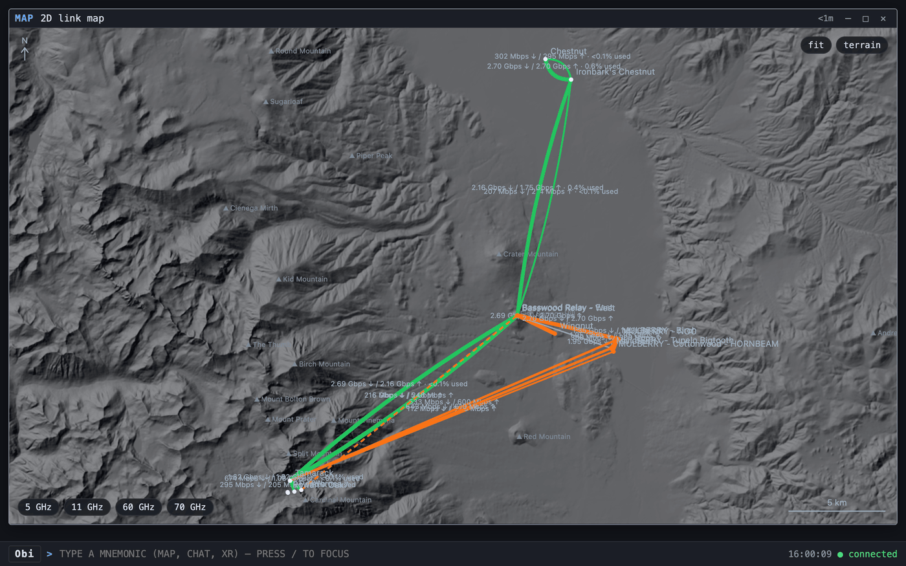
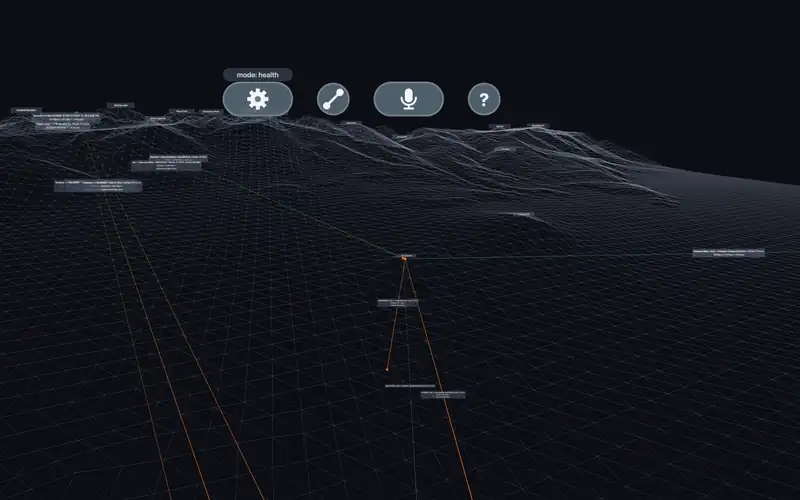
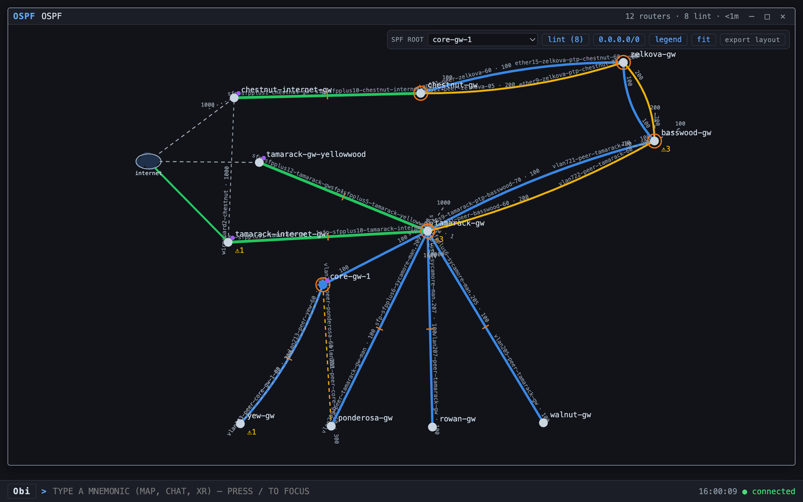
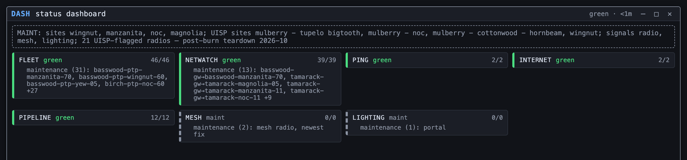

# obi

obi is a network management assistant for any network: a campus, a WISP, a branch fleet or a
single site. It collects inventory, health, metrics, logs and config history from your routers,
switches, radios and access points, and puts an LLM in front of it.

- **Ask it.** Questions from the terminal, Slack, a browser workspace, by voice or over a two-way
  radio.
- **It watches on its own.** An hourly LLM review of logs and metrics posts findings to Slack,
  and a status dashboard pages on outages. Reacting to events as they happen (SNMP traps,
  syslog) is next.

It grew up running the backbone of a large temporary event network (dozens of routers and
point-to-point radios over many kilometres, run by a small volunteer team), so it is built for
small teams with a lot of gear and little time.

- **Read-only by design.** The only device writes are allowlisted, audited decorative lighting.
- **No deployment identity in the code.** Addresses, names, coordinates and IDs live in your
  config and state; the examples and test data describe a fictional network
  ([details](docs/setup/identity.md)).
- **Optional features stay off** until you configure them.

**[Try the live demo](https://sevaepsteyn.github.io/obi/)**: the browser workspace on a fictional
network, with recorded chats replayed. It runs entirely in your browser.


## What it does

<table>
<tr>
<td width="50%" valign="top"><b>Discovery and status</b><br>Crawl MikroTik RouterOS neighbors within a scope; live health per device<br><sub>Guide: <a href="docs/guide/routeros.md">routeros</a></sub></td>
<td width="50%"><a href="docs/guide/routeros.md"></a></td>
</tr>
<tr>
<td width="50%" valign="top"><b>Ubiquiti UISP</b><br>The controller's device fleet, plus wireless link health for every point-to-point radio<br><sub>Guide: <a href="docs/guide/vendors.md#uisp">vendors § UISP</a></sub></td>
<td width="50%"><a href="docs/guide/vendors.md#uisp"></a></td>
</tr>
<tr>
<td width="50%" valign="top"><b>Siklu EtherHaul</b><br>E-band radios read live over SSH; the two ends of each hop paired into one link<br><sub>Guide: <a href="docs/guide/vendors.md#siklu">vendors § Siklu</a></sub></td>
<td width="50%"><a href="docs/guide/vendors.md#siklu"></a></td>
</tr>
<tr>
<td colspan="2" valign="top"><b>NetBox</b><br>Your documented inventory, and its drift from what is actually on the network<br><sub>Guide: <a href="docs/guide/vendors.md#netbox">vendors § NetBox</a></sub></td>
</tr>
<tr>
<td width="50%" valign="top"><b>Metrics</b><br>Live SNMP from any vendor, plus history in a local store<br><sub>Guide: <a href="docs/guide/metrics.md">metrics</a></sub></td>
<td width="50%"><a href="docs/guide/metrics.md"></a></td>
</tr>
<tr>
<td width="50%" valign="top"><b>Logs</b><br>Device syslog, UniFi and UISP controller events in one searchable store<br><sub>Guide: <a href="docs/guide/logs.md">logs</a></sub></td>
<td width="50%"><a href="docs/guide/logs.md"></a></td>
</tr>
<tr>
<td width="50%" valign="top"><b>Config backup</b><br>RouterOS <code>/export</code> into git, secrets redacted, diffs on change<br><sub>Guide: <a href="docs/guide/config-backup.md">config-backup</a></sub></td>
<td width="50%"><a href="docs/guide/config-backup.md"></a></td>
</tr>
<tr>
<td width="50%" valign="top"><b>Ask obi</b><br>Chat in the terminal, Slack, Claude Desktop / Claude Code (MCP)<br><sub>Guide: <a href="docs/guide/chat.md">chat</a></sub></td>
<td width="50%"><a href="docs/guide/chat.md"></a></td>
</tr>
<tr>
<td colspan="2" valign="top"><b>Voice and radio</b><br>Push-to-talk in the terminal and browser; a walkie-talkie station<br><sub>Guide: <a href="docs/guide/voice.md">voice</a>, <a href="docs/setup/radio.md">radio</a></sub></td>
</tr>
<tr>
<td width="50%" valign="top"><b>Web workspace</b><br>Multi-window browser terminal and a 2D link map<br><sub>Guide: <a href="docs/guide/web.md">web</a></sub></td>
<td width="50%"><a href="docs/guide/web.md"></a></td>
</tr>
<tr>
<td width="50%" valign="top"><b>3D / AR / VR link viewer</b><br>Every link in 3D over the terrain, in a WebXR headset: fly, turn and zoom anywhere, and switch between health, signal, utilization and Fresnel clearance<br><sub>Guide: <a href="docs/guide/web.md#the-3darvr-viewer-xr-quest-3">web § XR</a></sub></td>
<td width="50%"><a href="docs/guide/web.md#the-3darvr-viewer-xr-quest-3"></a></td>
</tr>
<tr>
<td width="50%" valign="top"><b>OSPF routing</b><br>Topology map with per-direction costs, the SPF tree from any router, single points of failure, each router's internet egress, and a config lint<br><sub>Guide: <a href="docs/guide/web.md#ospf-routing-map">web § OSPF</a></sub></td>
<td width="50%"><a href="docs/guide/web.md#ospf-routing-map"></a></td>
</tr>
<tr>
<td colspan="2" valign="top"><b>Watcher</b><br>Hourly LLM review of logs and metrics, findings to Slack<br><sub>Guide: <a href="docs/guide/watcher.md">watcher</a></sub></td>
</tr>
<tr>
<td width="50%" valign="top"><b>Dashboard and paging</b><br>One status board, maintenance mode, pager alerts<br><sub>Guide: <a href="docs/guide/dashboard.md">dashboard</a>, <a href="docs/setup/paging.md">paging</a></sub></td>
<td width="50%"><a href="docs/guide/dashboard.md"></a></td>
</tr>
<tr>
<td width="50%" valign="top"><b>Audit trail</b><br>Every query, tool call and write, full-text searchable<br><sub>Guide: <a href="docs/guide/audit.md">audit</a></sub></td>
<td width="50%"><a href="docs/guide/audit.md"></a></td>
</tr>
<tr>
<td colspan="2" valign="top"><b>Services</b><br>Run the web, Slack, radio and mesh daemons under launchd<br><sub>Guide: <a href="docs/guide/services.md">services</a></sub></td>
</tr>
<tr>
<td colspan="2" valign="top"><b>Event extras</b><br>Weather, gate traffic, status lighting, Meshtastic location, city grid<br><sub>Guide: <a href="docs/guide/weather-traffic.md">weather-traffic</a>, <a href="docs/guide/lighting.md">lighting</a>, <a href="docs/guide/mesh.md">mesh</a></sub></td>
</tr>
<tr>
<td colspan="2" valign="top"><b>Demo</b><br>A sanitized dataset and a static, serverless demo (<a href="https://sevaepsteyn.github.io/obi/">live</a>)<br><sub>Guide: <a href="docs/guide/demo.md">demo</a></sub></td>
</tr>
</table>

## Quick start

Requires Python 3.12+ and [`uv`](https://docs.astral.sh/uv/).

```bash
uv sync    # creates the venv and installs from uv.lock
```

Create `~/.config/obi/config.toml` and `chmod 600` it (the password is plaintext; use a
read-only RouterOS user):

```toml
[discovery]
seeds  = ["192.0.2.1"]     # where the crawl starts
ranges = ["10.0.0.0/16"]   # the crawl never leaves these ranges

[routeros]
username = "obi-readonly"
password = "your-readonly-password"
use_tls  = true

[chat]                     # optional: or set ANTHROPIC_API_KEY
api_key = "sk-ant-..."
```

Then:

```bash
uv run obi routeros discover        # crawl from the seeds, write the inventory
uv run obi status                   # live health for every device in it
uv run obi chat "which devices have the highest CPU?"
```

Each other feature adds its own config section; its guide lists the keys. `obi --help` and
`obi <command> --help` describe every command.

## Documentation

- **Guides:** [docs/guide/](docs/guide/), one per feature (table above).
- **Setup:** [radio station](docs/setup/radio.md), [paging](docs/setup/paging.md),
  [keeping identity out of the repo](docs/setup/identity.md).
- **Network:** [RouterOS gateway template](docs/network/routeros-gateway-template.md).
- **Development:** [architecture and tests](docs/development/architecture.md), plus notes on
  the web widget language, XR navigation, the radio audio chain and the demo pipeline in
  [docs/development/](docs/development/).

## Develop

```bash
uv run pytest -q          # the full suite is hermetic: no devices, network or private config
uv run pytest -q -m 'not slow'   # inner loop: skip the demo snapshot/export pipeline
uv run ruff check . && uv run mypy src
```

A commit hook and a test keep deployment identity out of the tree
([how](docs/setup/identity.md)).

## License

[MIT](LICENSE) © Glivorem Technologies, LLC
