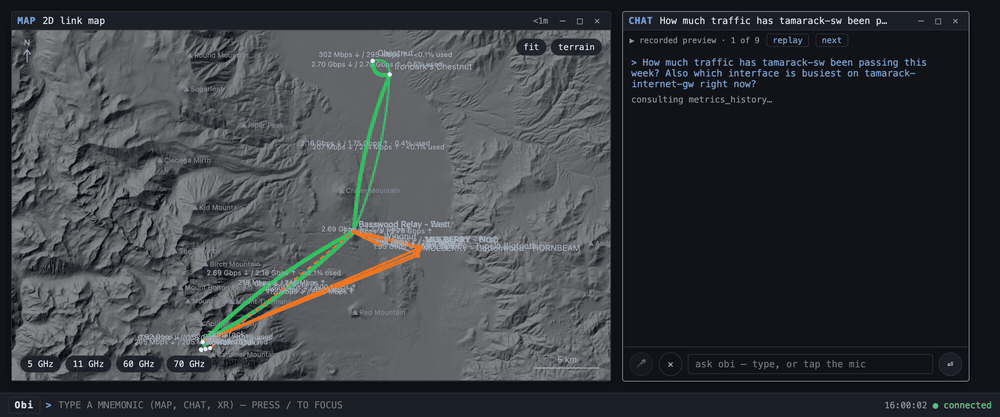
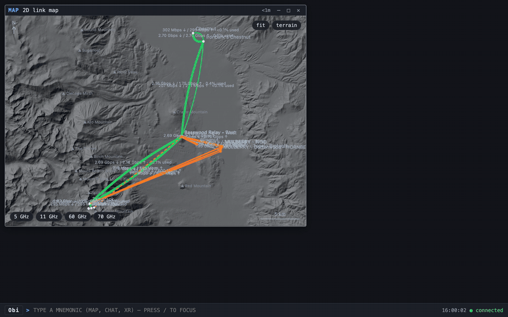
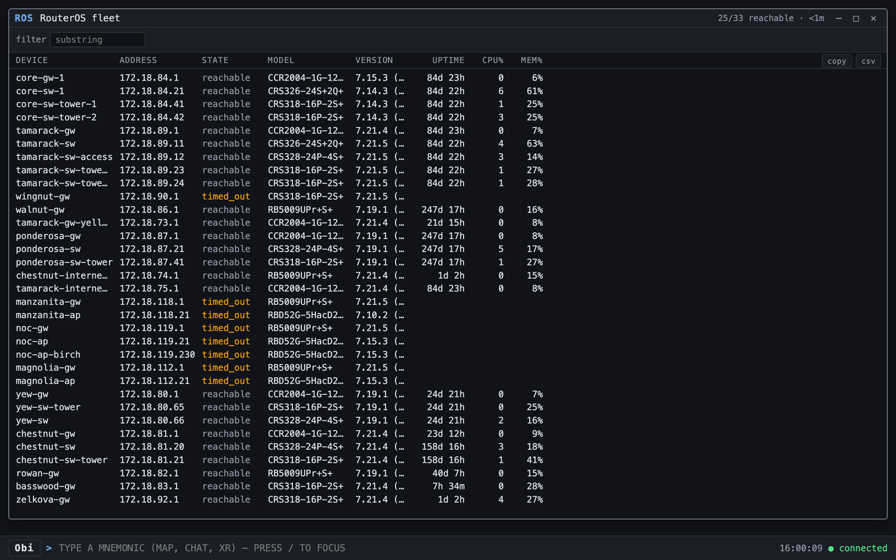
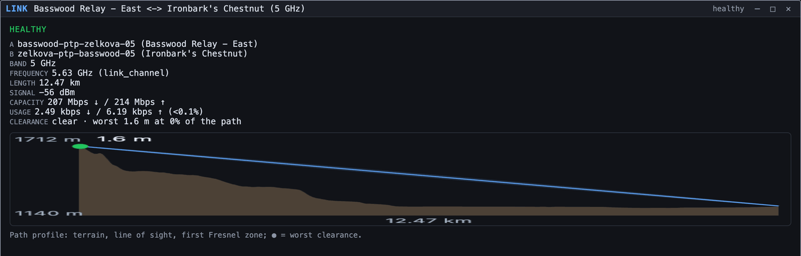
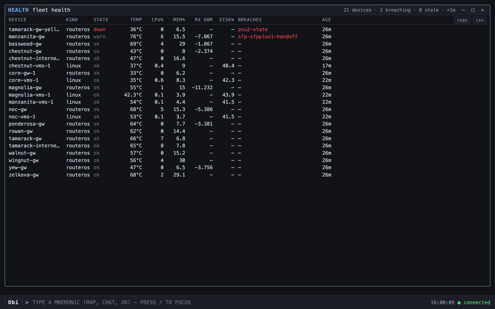
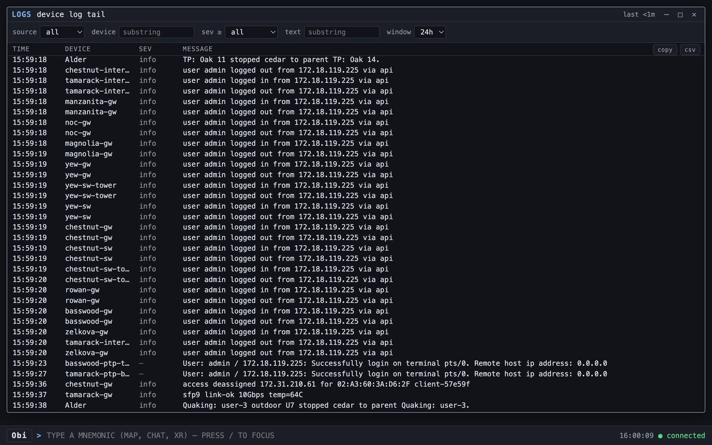
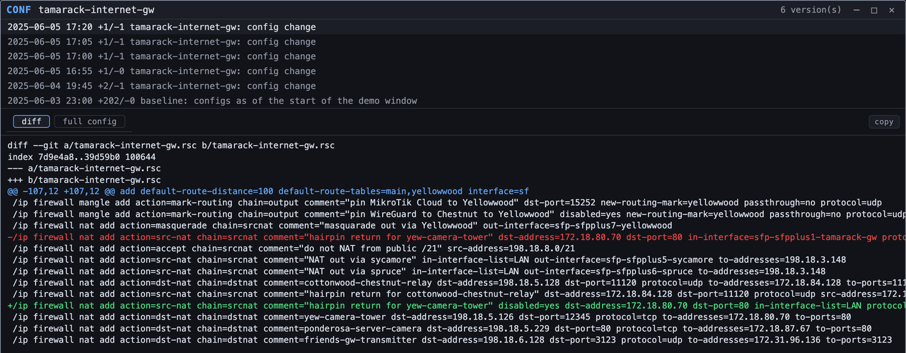
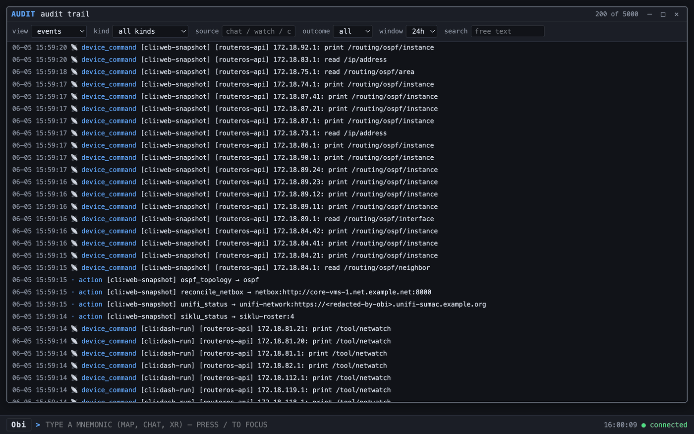

# obi

obi is a network operations assistant. It was built to run the backbone of a large temporary
event network: dozens of routers, point-to-point radios and access points, spread over many
kilometres and looked after by a small volunteer team.

It collects inventory, health, metrics, logs and config history from the gear, and puts an LLM
in front of it. You can ask it questions from the terminal, Slack, a browser workspace, by voice
or over a two-way radio.

- **Read-only by design.** The only device writes are allowlisted, audited decorative lighting.
- **No deployment identity in the code.** Addresses, names, coordinates and IDs live in your
  config and state; the examples and test data describe a fictional network
  ([details](docs/setup/identity.md)).
- **Optional features stay off** until you configure them.

**[Try the live demo](https://sevaepsteyn.github.io/obi/)**: the browser workspace on a fictional
network, with recorded chats replayed. It runs entirely in your browser.





## What it does

| Area | What you get | Guide |
|---|---|---|
| Discovery and status | Crawl MikroTik RouterOS neighbors within a scope; live health per device | [routeros](docs/guide/routeros.md) |
| Other vendors | Ubiquiti UISP (incl. wireless link health), Siklu EtherHaul, NetBox drift | [vendors](docs/guide/vendors.md) |
| Metrics | Live SNMP from any vendor, plus history in a local store | [metrics](docs/guide/metrics.md) |
| Logs | Device syslog, UniFi and UISP controller events in one searchable store | [logs](docs/guide/logs.md) |
| Config backup | RouterOS `/export` into git, secrets redacted, diffs on change | [config-backup](docs/guide/config-backup.md) |
| Ask obi | Chat in the terminal, Slack, Claude Desktop / Claude Code (MCP) | [chat](docs/guide/chat.md) |
| Voice and radio | Push-to-talk in the terminal and browser; a walkie-talkie station | [voice](docs/guide/voice.md), [radio](docs/setup/radio.md) |
| Web workspace | Multi-window browser terminal, 2D map, 3D/AR/VR link viewer | [web](docs/guide/web.md) |
| OSPF routing | Topology map with per-direction costs, the SPF tree from any router, single points of failure, each router's internet egress, and a config lint | [web § OSPF](docs/guide/web.md#ospf-routing-map) |
| Watcher | Hourly LLM review of logs and metrics, findings to Slack | [watcher](docs/guide/watcher.md) |
| Dashboard and paging | One status board, maintenance mode, pager alerts | [dashboard](docs/guide/dashboard.md), [paging](docs/setup/paging.md) |
| Audit trail | Every query, tool call and write, full-text searchable | [audit](docs/guide/audit.md) |
| Services | Run the web, Slack, radio and mesh daemons under launchd | [services](docs/guide/services.md) |
| Event extras | Weather, gate traffic, status lighting, Meshtastic location, city grid | [weather-traffic](docs/guide/weather-traffic.md), [lighting](docs/guide/lighting.md), [mesh](docs/guide/mesh.md) |
| Demo | A sanitized dataset and a static, serverless demo ([live](https://sevaepsteyn.github.io/obi/)) | [demo](docs/guide/demo.md) |

<table>
<tr>
<td width="33%" valign="top"><a href="docs/guide/routeros.md"></a><br><sub><b>RouterOS fleet</b></sub></td>
<td width="33%" valign="top"><a href="docs/guide/vendors.md"></a><br><sub><b>Link and path profile</b></sub></td>
<td width="33%" valign="top"><a href="docs/guide/metrics.md"></a><br><sub><b>Metrics history</b></sub></td>
</tr>
<tr>
<td width="33%" valign="top"><a href="docs/guide/metrics.md"></a><br><sub><b>Fleet health</b></sub></td>
<td width="33%" valign="top"><a href="docs/guide/logs.md"></a><br><sub><b>Logs</b></sub></td>
<td width="33%" valign="top"><a href="docs/guide/config-backup.md"></a><br><sub><b>Config diffs</b></sub></td>
</tr>
<tr>
<td width="33%" valign="top"><a href="docs/guide/web.md"></a><br><sub><b>OSPF map</b></sub></td>
<td width="33%" valign="top"><a href="docs/guide/dashboard.md"></a><br><sub><b>Status dashboard</b></sub></td>
<td width="33%" valign="top"><a href="docs/guide/audit.md"></a><br><sub><b>Audit trail</b></sub></td>
</tr>
</table>

## Quick start

Requires Python 3.12+ and [`uv`](https://docs.astral.sh/uv/).

```bash
uv sync    # creates the venv and installs from uv.lock
```

Create `~/.config/obi/config.toml` and `chmod 600` it (the password is plaintext; use a
read-only RouterOS user):

```toml
[discovery]
seeds  = ["192.0.2.1"]     # where the crawl starts
ranges = ["10.0.0.0/16"]   # the crawl never leaves these ranges

[routeros]
username = "obi-readonly"
password = "your-readonly-password"
use_tls  = true

[chat]                     # optional: or set ANTHROPIC_API_KEY
api_key = "sk-ant-..."
```

Then:

```bash
uv run obi routeros discover        # crawl from the seeds, write the inventory
uv run obi status                   # live health for every device in it
uv run obi chat "which devices have the highest CPU?"
```

Each other feature adds its own config section; its guide lists the keys. `obi --help` and
`obi <command> --help` describe every command.

## Documentation

- **Guides:** [docs/guide/](docs/guide/), one per feature (table above).
- **Setup:** [radio station](docs/setup/radio.md), [paging](docs/setup/paging.md),
  [keeping identity out of the repo](docs/setup/identity.md).
- **Network:** [RouterOS gateway template](docs/network/routeros-gateway-template.md).
- **Development:** [architecture and tests](docs/development/architecture.md), plus notes on
  the web widget language, XR navigation, the radio audio chain and the demo pipeline in
  [docs/development/](docs/development/).

## Develop

```bash
uv run pytest -q          # the full suite is hermetic: no devices, network or private config
uv run pytest -q -m 'not slow'   # inner loop: skip the demo snapshot/export pipeline
uv run ruff check . && uv run mypy src
```

A commit hook and a test keep deployment identity out of the tree
([how](docs/setup/identity.md)).

## License

[MIT](LICENSE) © Glivorem Technologies, LLC
