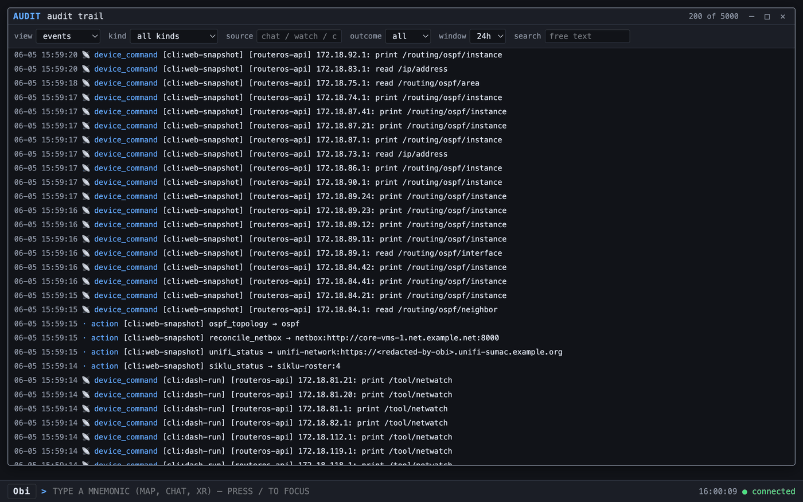

# Audit trail

obi records everything it does into a local, queryable event store, so "what did obi do, and why?" is always answerable afterwards. `obi audit` and the web `AUD` board read it.



<sub>Screenshots from the demo: a fictional network, sanitized from real data.</sub>

## What is recorded

- **LLM communication** — full prompt and response, model, token usage — across chat, voice, Slack and the watcher's judge.
- **Tool calls** the model makes — name, arguments, result, duration.
- **Device and vendor commands** — RouterOS API operations, SSH `/export` and Siklu `show` commands, SNMP gets/walks, UISP/UniFi/NetBox HTTP reads.
- **Human communication** — chat/voice/Slack turns in both directions, and watch reports.

Events are grouped by **session** (a chat conversation, a Slack thread, one watch cycle, one CLI invocation). A whole interaction reconstructs in causal order: question → model call → tool call → device commands → answer.

## Properties

- **On by default** and strictly local: `~/.local/state/obi/audit.db` (SQLite).
- **Fail-open:** a recording problem never breaks the operation being recorded.
- **Self-pruning** by age (`retention_days`).
- **Redaction backstop:** every configured secret (passwords, tokens, SNMP communities, API keys) is scrubbed from every payload before storage.
- Inspecting the trail is never itself audited.
- The older intent log, `~/.local/state/obi/audit.jsonl`, keeps working unchanged; the event store is the full-payload, queryable half.

## Config

```toml
[audit]                       # optional — capture is ON by default
# enabled = true              # false turns capture off
# db_path = "~/.local/state/obi/audit.db"
# retention_days = 90         # self-pruning age
# max_payload_bytes = 500000  # per payload field; beyond it, an explicit truncation marker
```

## Commands

```bash
obi audit status                     # store health: size, counts, oldest/newest
obi audit list --since 1h            # recent events (newest first)
obi audit list --kind llm_call --source watch --since 1d
obi audit list --text core-gw-1 --outcome error
obi audit show 123                   # one event's complete payload (full prompt/response…)
obi audit trace chat-1a2b3c4d5e6f    # a whole conversation, causally ordered
obi audit stats --since 7d           # volumes by kind/source, token usage, top tools/targets
obi audit list --json | jq .         # every view has --json
```

## Web board

The **`AUD`** board in the [web terminal](./web.md) shows the same trail interactively: a live filterable event list, click-through detail (LLM calls render as the conversation), session-trace navigation, and analytics (token usage over time, volumes, top tools/targets).
