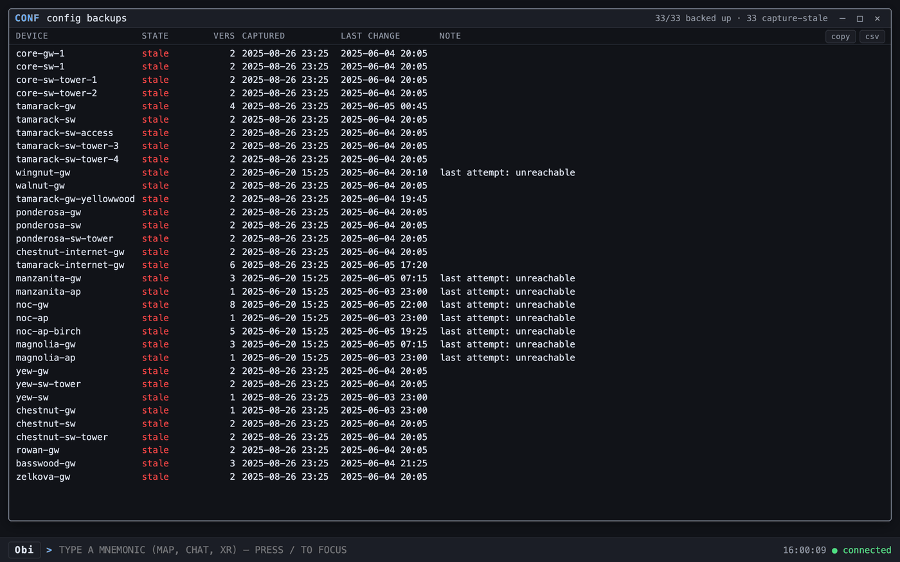
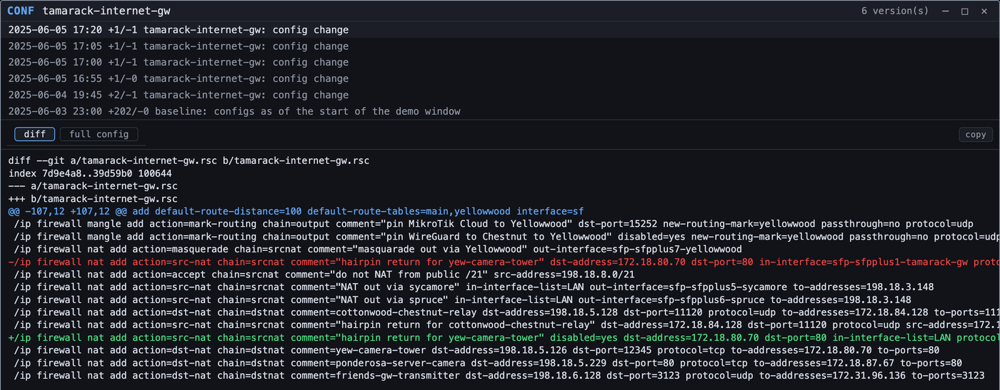

# RouterOS config backup

`obi configs` keeps a versioned, redacted backup of every RouterOS device's configuration in a local git repository, giving you the current config plus full change history. It is strictly read-only: obi runs `/export` over SSH and never writes to a device.





<sub>Screenshots from the demo: a fictional network, sanitized from real data.</sub>

## Device requirement: SSH policy

The RouterOS binary API can't return an `/export` to a read-only account without writing a `.rsc` file onto the device, which obi won't do. SSH exec works, so the backup account's group **must include the `ssh` policy**. A read-only user is otherwise fine: `/export` without `show-sensitive` reveals no secrets.

```
/user group set read policy=read,test,winbox,api,ssh,!sensitive
```

## Config

RouterOS only; targets come from the `[routeros]` roster ([routeros.md](./routeros.md)). The section's presence opts you in, and credentials fall back to `[routeros]`.

```toml
[configs]                 # presence enables `obi configs ingest`
# username / password     # optional — omit to reuse the [routeros] account
# ssh_port    = 22
# timeout     = 10.0      # seconds per device (/export is slower than a status read)
# concurrency = 8
# targets     = ""        # roster-identity substring; "" = every identified device
# repo_path   = "~/.local/state/obi/config-repo"
# verbose     = false     # true = /export verbose (include default values)
```

## Commands

```bash
obi routeros discover                            # ensure the inventory roster exists
obi configs ingest                               # SSH /export each device, commit only changed ones
obi configs status                               # coverage: who's backed up, freshness, orphans
obi configs show core-gw-1 --contains firewall   # current config (redacted), firewall only
obi configs show core-gw-1 --at 1w               # as of a week ago
obi configs history core-gw-1                    # change points (git history)
obi configs diff core-gw-1 --since 1w            # what changed in the last week
```

## Behaviour

- **Format.** obi captures `/export terse` (one command per line), which gives clean, meaningful diffs.
- **Secrets.** `/export` hides passwords, wireless keys and IPsec secrets. The one value it leaves cleartext, the **SNMP community**, is scrubbed before storing, so no secret enters the repo.
- **Commits only on change.** The volatile `/export` timestamp header is normalized away, so an unchanged device never produces a commit.
- **Failures.** An unreachable device is recorded and skipped without affecting the others; its last-known version is retained.
- **Audit.** Every run writes one audit record with counts only, never config text ([audit.md](./audit.md)).

## Scheduling

Run `obi configs ingest` from cron, staggered beside the other ingest jobs. Hourly is plenty, since config drift is slower than telemetry:

```
25 * * * *  obi configs ingest
```

## In chat

The `config_query` tool answers from the local backup ([chat.md](./chat.md)), for example *"show core-gw-1's firewall rules"*, *"what changed on the gateway config last week?"* or *"when did NAT last change on core-gw-1?"*. The [watcher](./watcher.md) can also alert on config changes.
