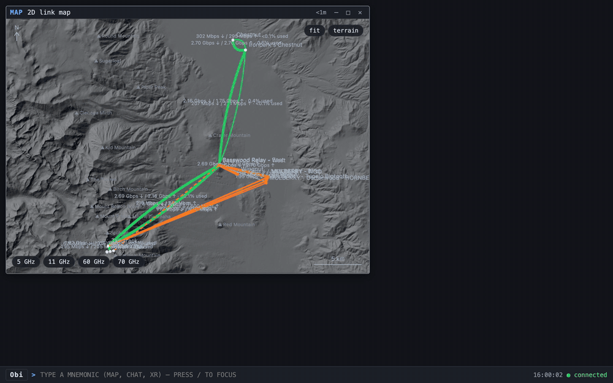

# Demo dataset (`obi demo`)

`obi demo snapshot` turns this host's stores into a self-contained dataset of a fictional network, **Example Valley Net**. The public demo workspace, docs and videos are all built from that dataset, never from live data.



<sub>Screenshots from the demo: a fictional network, sanitized from real data.</sub>

## The dataset

The snapshot:

- remaps every name, address, MAC, serial and person consistently;
- removes secrets entirely;
- moves the whole network rigidly to a different valley;
- shifts time by whole weeks.

An independent leak gate refuses to publish if any real identifier survives. The command is read-only toward devices and live stores.

```bash
uv run obi demo snapshot --dry-run --out ~/obi-demo/dataset   # preview; writes nothing
uv run obi demo snapshot --out ~/obi-demo/dataset             # stage → gate → publish
uv run obi demo gate ~/obi-demo/dataset                       # re-check any time
```

It needs a private `~/.config/obi/demo-denylist.txt` (chmod 600). The `[demo]` profile, exit codes and internals are in [demo-dataset.md](../development/demo-dataset.md).

## Static public demo

The real workspace running with no server, plus a replay of operator-approved past chats. It can be hosted on GitHub Pages or any static host.

```bash
uv run obi demo chats list --since 90d    # curate the chat preview (show / approve / revoke)
uv run obi demo export                    # render → gate → ~/obi-demo/bundle
uv run obi web serve --demo               # preview at http://127.0.0.1:8765/obi/
uv run obi demo publish --pages --vm      # only the exact gated bundle leaves the machine
```

See [static-demo.md](../development/static-demo.md) for the build and publish details.
