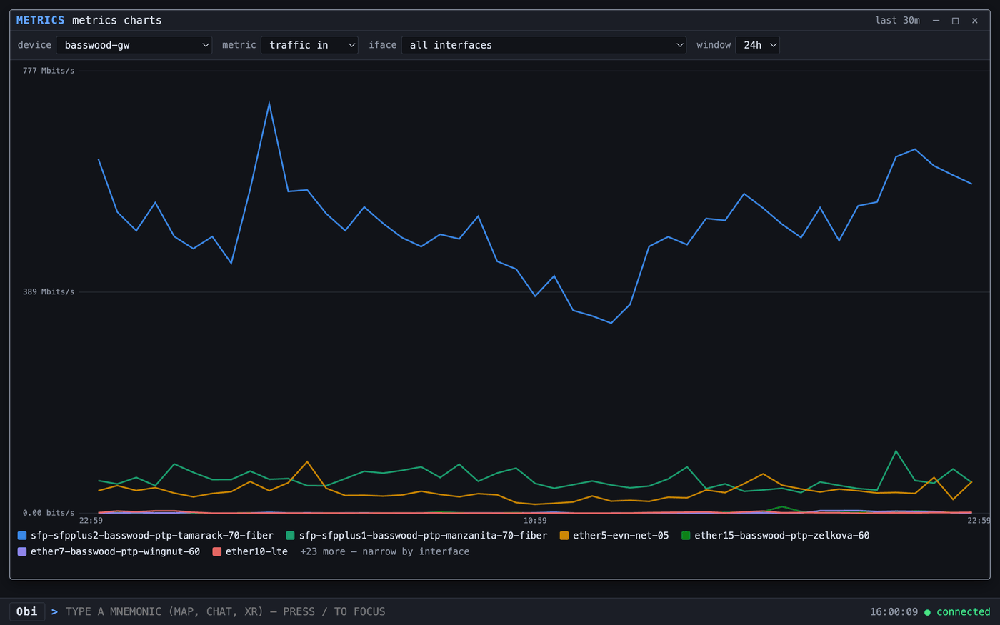
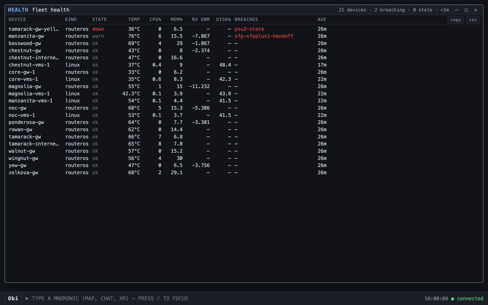

# Metrics: live SNMP and history

obi reads SNMP metrics read-only from the devices it already knows, either as a live spot-read (`obi metrics live`) or via a scheduled collector that stores readings for trend queries (`obi metrics history`).





<sub>Screenshots from the demo: a fictional network, sanitized from real data.</sub>

## Live SNMP (`obi metrics live`)

SNMP is the cross-vendor path for interface traffic, per-port up/down state, and device CPU, memory and uptime. Targets are the Mikrotik discovered roster and NetBox-documented hosts.

- Read-only: GET/GETNEXT/GETBULK only, never SET.
- Real-time only; for stored readings see [History](#history-obi-metrics-history) below.

```toml
[snmp]                 # optional; layers over your existing rosters
version   = "v2c"      # "v2c" (community) or "v3" (authenticated + encrypted)
community = "public"   # required for v2c; a credential
port      = 161
timeout   = 5.0        # per target; a dead agent never stalls the sweep
profile   = "system"   # default metric group: "system" or "interfaces"
# v3 instead: version = "v3", v3_username, v3_auth_key, v3_priv_key (all secrets)
```

```bash
uv run obi metrics live                                           # system metrics, every known device
uv run obi metrics live --target core-gw-1 --profile interfaces   # per-port status + counters
uv run obi metrics live --source netbox --json | jq .             # snmp-report schema
```

- Each device gets an explicit outcome: reachable, auth-failed, unreachable, or timed-out.
- A device with SNMP off, a wrong community, or a slow agent never aborts the sweep or drops the others.
- The community string and v3 keys appear in no output, log, or audit record.

You can also ask in chat: `obi chat "show me the interface traffic on core-gw-1 over SNMP"`. See [chat.md](./chat.md).

## History (`obi metrics history`)

A scheduled collector polls your Mikrotik gateways over SNMP and stores each reading in a local SQLite time-series store, separate from the logs DB. It is read-only, fully offline, and opt-in.

Adding `[snmp.history]` under `[snmp]` opts in. With only `[snmp]`, the collector is inactive and `obi metrics live` is unchanged.

```toml
[snmp]                       # required; the collector reuses this credential
version   = "v2c"
community = "your-ro-community"

[snmp.history]               # presence opts in
db_path  = "~/.local/state/obi/metrics.db"   # separate from logs.db
targets  = "-gw"                             # name-substring filter on roster identity
profiles = ["interfaces", "system"]          # interface counters + system gauges
retain   = "90d"                             # older readings are pruned each cycle
```

Each cycle collects, per matched gateway:

- Every interface's in/out **octets**, **errors**, **discards**, plus `ifOperStatus`.
- System gauges: **CPU**, **memory**, **uptime**.

```bash
uv run obi metrics ingest                                                       # one cycle: poll → store → prune
uv run obi metrics history --target core-gw-1 --metric ifHCInOctets --since 24h # per-interface rates
uv run obi metrics history --target core-gw-1 --metric ifInErrors --interface sfp-sfpplus6 --since 7d
uv run obi metrics history --target core-gw-1 --metric cpuLoad --since 2d       # gauge trend
uv run obi metrics status                                                       # readings, devices, retention
uv run obi metrics history --target core-gw-1 --metric ifHCInOctets --json | jq .
```

### Behaviour and limits

- Counter metrics are returned as **rates** from consecutive readings.
- A reboot (counter reset) drops just that interval; a collection gap is spanned with the real elapsed time, so there is no false spike.
- Any window is auto-bucketed (~60 buckets, avg/min/max) to stay readable.
- **No backfill**: history is only as deep as the collector has been running (bounded by `retain`), and a missed cycle is a permanent gap.
- SNMP credentials appear in no output, log, or audit record.

### Scheduling

Run `obi metrics ingest` from cron, **staggered** beside the other ingest jobs (e.g. `3-59/5`).
