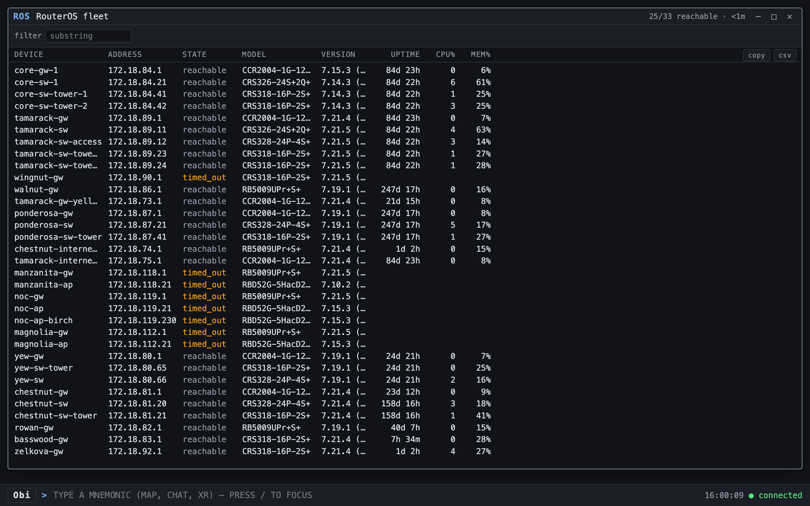
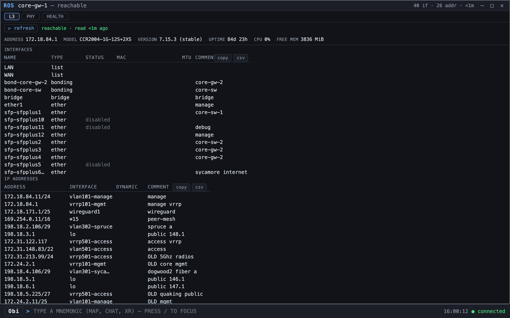

# RouterOS discovery and status

obi crawls a MikroTik (RouterOS) network from a few seed devices, writes a durable inventory, and reports each device's live health. It is strictly read-only: it never changes device or network state.

- **`obi routeros discover`** (run occasionally) follows each device's neighbor table outward, bounded by your scope, and writes the **inventory**: identity, address and provenance, no live health.
- **`obi status`** (run often) treats that inventory as the source of truth and reports live health (uptime, CPU, memory) as a table or JSON.
- **`obi chat`** answers questions about the same data in plain language — see [chat.md](./chat.md).

A slow or unreachable device never blocks the rest. The crawl is hard-bounded by scope, a visited set and a time budget, and every action is recorded in the [audit trail](./audit.md).





<sub>Screenshots from the demo: a fictional network, sanitized from real data.</sub>

## Install

[`uv`](https://docs.astral.sh/uv/) manages Python, the venv and dependencies.

```bash
uv sync   # creates the venv and installs from uv.lock
```

## Configure

Create `~/.config/obi/config.toml`:

```toml
[discovery]
seeds  = ["192.0.2.1"]     # where the crawl starts
ranges = ["10.0.0.0/16"]   # the crawl boundary: neighbors are followed only inside this

[routeros]
username = "obi-readonly"
password = "your-readonly-password"   # plaintext — protect the file
use_tls  = true                       # false = plain API port 8728

# Optional:
# [connection]
# timeout = 4        # per-device probe/query timeout (s)
# concurrency = 16   # max concurrent probes/queries
# budget = 30        # total crawl wall-clock budget (s)
# [audit]
# path = "~/.local/state/obi/audit.jsonl"
# [inventory]
# path = "~/.local/state/obi/inventory.json"
```

- **Boundary.** The crawl follows neighbors only to addresses inside the configured scope. Seeds alone bound it to exactly those seeds; to map a network, set the `ranges` that bound it. This containment is intentional.
- **Credentials.** The password is plaintext, so `chmod 600 ~/.config/obi/config.toml`. Use a least-privilege, read-only RouterOS user — that is the real blast-radius control.

For a device-side baseline, see the [RouterOS gateway template](../network/routeros-gateway-template.md).

## Run

```bash
# Build / refresh the inventory (occasionally)
uv run obi routeros discover                 # crawl from seeds → write inventory.json
uv run obi routeros discover --json | jq .   # the inventory document
uv run obi routeros discover --budget 60     # allow a longer crawl

# Report live health from the inventory (often)
uv run obi status                  # all configured vendors, one section each
uv run obi status --json | jq .    # machine-readable JSON
uv run obi routeros status         # just the MikroTik section
```

- **discover** records every device found with its **provenance** (seed / neighbor-of). Non-MikroTik nodes are recorded as `unsupported` and never traversed.
- **status** queries exactly the inventory's devices and prints every roster entry with reachability, raw metrics and discovery state.
- Re-running `discover` refreshes the roster: new devices are added, vanished ones flagged `absent`.
- With no inventory yet, `obi status` tells you to run `obi routeros discover` first and exits `2`.
- Each vendor has a scoped view: `obi routeros status`, `obi uisp status` and `obi unifi status` print only that vendor's section ([vendors.md](./vendors.md)).
- Exit codes: `0` = produced a result (even if devices are down or none were found); `2` = usage/config error or status without an inventory.
- Every crawl, probe and query is appended to the intent log: `tail ~/.local/state/obi/audit.jsonl`.
