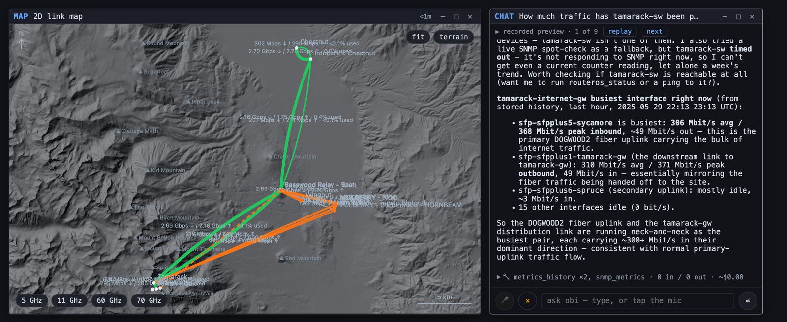

# Web terminal (2D + 3D/AR/VR)

`obi web` serves a dark, terminal-style workspace to any browser on the LAN, each tool in its own floating window. The same server hosts a 2D link map and an immersive 3D/AR/VR viewer for Quest 3.



## Overview

- Read-only end to end. Needs `[uisp]`: the controller provides coordinates and link topology.
- The server serves only local files and cron snapshots, except the ROS drill-down and PING/TRACE, which reach a RouterOS device on operator action.
- Works offline after the first export: three.js is vendored (no CDN); the 2D map is plain canvas with no basemap or tiles.
- Every board's data matches its CLI `--json` output exactly.

## Starting it

```bash
uv run obi web export    # geometry → ~/.local/state/obi/ar/links.json (atomic, audited)
uv run obi web serve     # HTTPS on the LAN (default 8443); prints the URL(s) to open
```

- The first export fetches each site's ground elevation from USGS once and caches it durably.
- HTTPS uses a self-signed certificate, generated once; accept the browser warning once per device. WebXR and browser microphones need a secure origin.

```cron
2-59/5 * * * * .../.venv/bin/obi web export   >> ~/.local/state/obi/ar-export.log 2>&1
4-59/5 * * * * .../.venv/bin/obi web snapshot >> ~/.local/state/obi/web-snapshot.log 2>&1
```

- **export** refreshes link geometry, health, terrain and clearance. Both viewers poll every 5 minutes and update in place without resetting viewpoint, selection or zone toggle.
- If the controller is unreachable, export exits and the last good data keeps being served. Both viewers show the data's age.
- **snapshot** writes the files the tool boards read; the `:04` offset keeps it clear of the logs-sync, metrics and export crons.
- A tool snapshots only if its config section exists. `--only uisp-links,status` lets you run some tools on a faster cadence.

## Configuration

`[web]` is optional; every field has a default (it also tunes paths, port and heuristics).

```toml
[web]
# include_siklu = true       # merge the Siklu e-band hop into the viewers
# gnis_states = ["NV"]       # opt in to named-peak labels from the USGS GNIS gazetteer
# voice = true               # false → TALK shows "voice is off"
# ospf_layout_path = "~/.config/obi/ospf-layout.json"   # blessed OSP layout (see OSP below)

# Hand-fix a site's ground height in metres (UISP altitudes are mixed-datum):
# [web.ground_overrides]
# "Hilltop Relay" = 1370.0
```

Every resolved height records its provenance in the export. PING/TRACE and the ROS drill-down also need `[routeros]`; without it the widget says so.

## The workspace

Windows drag, resize, snap to half/quarter, minimize and maximize; the arrangement is saved per browser.

- Open tools from the command line (`/` focuses it; type a mnemonic like `MAP` and press Enter) or the `[+ widget]` menu (for touch).
- Any widget runs full-page at `?w=<id>` (`?w=map`, `?w=talk`, `?w=xr`); old `?version=2d|3d` URLs redirect there.
- On headset browsers the XR window opens by default.
- A new tool is one registry entry plus one widget module. See [web-widget-language.md](../development/web-widget-language.md).

| Widget | Shows |
|---|---|
| MAP | 2D link map |
| TALK | Ask-obi chat, voice + text |
| XR | Setup for the 3D/AR/VR session |
| LOGS | Device-log tail |
| UISP / SIK / UNIFI | UISP devices / Siklu radios / UniFi devices |
| LINKS | Every wireless backhaul link (UISP PtP + Siklu pairs): up/down, signal, band |
| ROS | RouterOS fleet: address, state, model, version, uptime, CPU, memory |
| NBX / WATCH | NetBox drift / watcher findings |
| MET | Metrics charts: reset-safe rates, gaps drawn as gaps, one line per interface |
| CFG | Config-backup coverage, history, diffs, full configs |
| HEALTH | Fleet hardware health |
| OSP | OSPF routing map |
| PING / TRACE | Live diagnostics from a chosen router |

**Tables**: click a header to cycle ascending / descending / original (numeric-aware, blanks last; sorting a log tail pauses auto-follow). Drag a boundary to resize (saved per widget; double-click resets).

**Copy and CSV**: every table copies its visible rows as tab-separated text and exports a `.csv` of the shown rows, generated in the browser. Every text pane (CFG, PING/TRACE, AUDIT, WATCH) has a copy button.

### Tool boards

Monospace boards with a text filter, counts, and data age on the window badge.

- UISP, LINKS, ROS, SIK, UNIFI and NBX read `obi web snapshot` files. If a controller is down, its board keeps the last good snapshot with a growing age.
- LINKS merges the `uisp-links` and `siklu` snapshots in the browser. If one is missing, the other still renders, the gap is named in the counts line, and the badge shows the OLDER age.
- WATCH reads the local watch-reports store live.

### ROS router detail

Click a ROS row, or type `/ROS <name>` or `/ROS <ip>`, to open that router's window. Several can be open at once, and they reopen after a reload.

- Shows IP addresses, interfaces with running/disabled status, and model, version, uptime, CPU, memory.
- Read live on open or refresh (`/interface`, `/ip/address`, `/system/resource`, print only), redacted and audited like any device read.
- A down router shows "unreachable" or "timeout" and keeps the last good data.
- A **HEALTH** tab shows the newest hardware readings with 24 h sparklines, from the local metrics store (no device contact).

### HEALTH, CFG, LOGS

- **HEALTH**: temperatures, PSU/fan, CPU/memory, SFP optics, collector-VM disks, worst-first with breaches colored. Thresholds are shared with `[watch.health]`, so board and Slack alerts agree. Click a RouterOS row to open its router. See [metrics.md](./metrics.md).
- **CFG**: reads the local config repo only. Toggle a diff to the full stored config, filter it to matching lines, copy it. See [config-backup.md](./config-backup.md).
- **LOGS**: RouterOS syslog plus UniFi and UISP events, severity-colored, live within ~20 s of ingest (scroll up to pause). Filters: source (`all / syslog / unifi / uisp`; `syslog` = device syslog only), device, minimum severity, text, time window. Served from `/api/logs.json`, which only reads `logs.db`; the badge shows the newest entry's age, so a stalled ingest is visible. See [logs.md](./logs.md).

### TALK and PING / TRACE

- **TALK**: hold the mic or type and press Enter. The transcript (questions, answers, tool-progress notes) is per session and never saved. Voice is on by default; with a missing STT/TTS dependency or `[web] voice = false` it shows "voice is off", and typing still works. See [voice.md](./voice.md).
- **PING / TRACE**: pick a source router, type a destination, and obi runs ping or traceroute **from that router** using the read-only `routeros_ping` / `routeros_traceroute` tools, audited with source `web`. On by default. See [routeros.md](./routeros.md).

### OSP (routing map)

The OSPF topology as a pannable graph: per-direction costs, SPF tree from any root, ghost/backup links, SPOF rings, the internet cloud with each router's default egress, and a lint window.

Dragged positions persist per browser and always win. Without a blessed layout, obi draws a hop-ring tree around the best-connected router, reordering branches only if that strictly reduces crossings.

To set the default layout for every browser:

1. Press **export layout** on the OSP toolbar (copies positions as JSON).
2. Save that JSON, unedited, to a file on the obi host.
3. Point `[web] ospf_layout_path` at it.

From the next snapshot, listed routers use the blessed position and unlisted ones keep the computed layout. Stale entries are ignored and counted in the snapshot `meta`. A missing or bad file never fails the export; the problem shows in `meta.layout_error`.

## The 2D map (MAP)

The network plotted by real coordinates, in any browser down to phone width (details become a bottom sheet). Pan, pinch-zoom; site labels, north arrow, scale bar, data age in the title bar.

- Links are colored by health; marginal or obstructed clearance is dashed.
- **Line thickness follows current capacity**, with a midpoint readout like `2.16 Gbps ↓ / 1.75 Gbps ↑ · 2.2% used`. With no controller numbers a link draws at neutral width and says capacity is *unavailable*, never zero.
- Links on devices in **maintenance mode are orange**, not red. See [dashboard.md](./dashboard.md).
- Tap a link for endpoints, sites, health, band/frequency, length, signal, per-direction capacity and usage, and the clearance verdict with worst margin and location. If the export has its terrain profile, an **elevation chart** shows terrain, line of sight, first Fresnel envelope and the worst point.

### Frequency bands (both viewers)

Toggles for 5, 11, 60 and 70 GHz (e-band), plus *other*; only bands in the data appear. They are chips in the 2D map corner and a palette at the left of view in the headset.

Hiding a band hides its lines, labels, Fresnel zones and profiles together, and the choice persists per browser.

### Siklu e-band hop

With `[siklu]` configured, export also reads the Siklu radios (read-only SSH, ~9 s) and adds their link as the 70 GHz group. See [vendors.md](./vendors.md).

- Geometry comes from the UISP radios on the same masts, capacity from the air interface; terrain and Fresnel are handled the same.
- Unreachable radios become a named exclusion, never a failed export. Opt out with `include_siklu = false`.

### Terrain and clearance

Export samples AWS Terrain Tiles (keyless; US data from USGS 3DEP) along every path and checks whether the ground enters the Fresnel zone.

- Includes 4/3-earth curvature and anchors the elevation model to per-site USGS grounds, so datum offsets can't invent obstructions.
- Marginal or obstructed links are named in the summary with worst margin and location (`--json`: `clearance_flagged`).
- Tiles and the gazetteer are cached under `~/.local/state/obi/ar/`, so later exports need no internet. Anything not buildable offline is skipped and named, never a failure.
- Scenery ships as a separate `terrain.json` loaded once per page, keeping the 5-minute poll light.

## The 3D/AR/VR viewer (XR, Quest 3)

Pick the site you're standing at, set eye height, and nudge the thumbstick until one link sits on a dish you can see; the rest falls into place. Leaving the session returns you to the workspace as you left it.

- **Fresnel zones** (A/X): translucent ellipsoids with a stronger 60% core that must stay clear. Look up from a mast and judge whether real trees or ridges intrude.
- Zone size uses each link's actual channel frequency from the controller. A link without a known frequency has no zone and is named in the summary.
- **Labels**: `name · 9.8 km · F1 11.6 m`, plus capacity/usage and maintenance when known, and `⚠ margin @ location` when flagged.
- Link tubes scale with capacity, like the 2D map. An earth-toned line under each path shows the ground profile.
- **Terrain wireframe** (B/Y, on by default). With `gnis_states` set, named summits are labeled; rotate a labeled peak onto the real one to align yaw.

Hands or controllers both work. Pan and zoom are clamped, so you can shrink the network to a tabletop or zoom to one link without losing it.

| Hands | Controllers | Action |
|---|---|---|
| pinch + drag | trigger + drag, or left stick | move the scene |
| two-hand pinch, turn | right stick ← → | rotate (yaw) |
| two-hand pinch, spread/squeeze | right stick ↑ ↓ | zoom |
| quick pinch tap | quick trigger tap, or A/X | toggle Fresnel zones |
| — | B/Y | toggle terrain + peak labels |
| pinch a band chip | trigger a band chip | toggle that band |
| pinch-hold the talk button | hold grip | push-to-talk |

See [xr-navigation.md](../development/xr-navigation.md) and [quest-debugging.md](../development/quest-debugging.md).

## Migration notes

The old `obi ar` viewer and `obi voice web` page are merged into `obi web`. The old commands fail naming their replacement, and a leftover `[ar]` section is a loud error.

1. Rename `[ar]` to `[web]` (keys unchanged); delete `[voice] web_port` / `web_bind` if set.
2. Change cron lines from `obi ar export` to `obi web export`.
3. Replace `obi ar serve [--voice]` (8443) and `obi voice web` (8444) with one `obi web serve`.

Port 8443, the certificate, the state directory and each device's trust step carry over. Nothing listens on 8444 afterwards.
